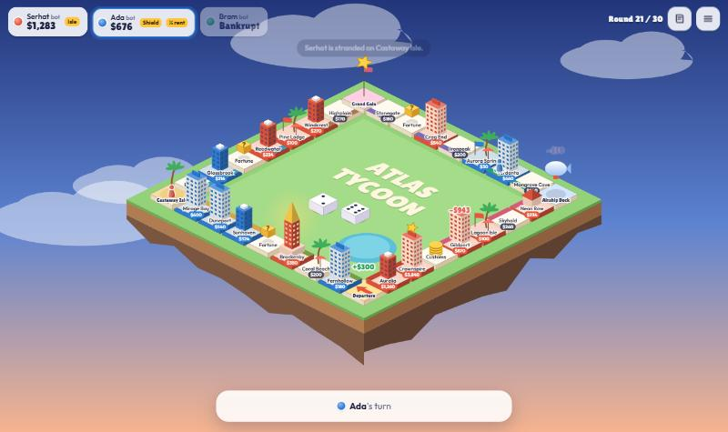

# Atlas Tycoon

A board game about buying cities, raising landmarks and chasing a monopoly on a floating isometric island. Play on one device, or online with up to four friends. No build step, no dependencies.



## Features

- Isometric board drawn on a canvas, with buildings that rise as you upgrade (villa, tower, hotel, landmark), hopping pawns, 3D dice, and zoom and pan.
- Online rooms with 5-letter codes and invite links. The server runs the game, so clients can't cheat, and a bot fills in for anyone who disconnects.
- Hot-seat play on one device, with any mix of humans and bots.
- A UI-agnostic rules engine with a seeded RNG, tested by 300 simulated bot games.

## Play

```bash
npm start
```

Then open http://localhost:5178.

- **Online:** "Create online room" gives you a 5-letter code and an invite link. Friends join with the code, and the host can fill empty seats with bots. If a player disconnects or takes longer than 45 seconds, a bot plays for them until they come back. Reloading the tab rejoins the same seat.
- **On this device:** 2–4 seats, each one a human (pass the device around) or a bot.

To play over the internet, run the server on any Node host (Render, Fly.io, Railway, a VPS), or expose your machine with a tunnel such as `cloudflared tunnel --url http://localhost:5178`. The port comes from `PORT`.

Pinch or scroll to zoom the board, drag to move it, and double-click to reset. Tap any tile to see its details.

## Rules in short

- Roll two dice. Doubles roll again; three doubles in a row strand you on **Castaway Isle**.
- Buy empty cities, and build on them right away if you like. On your first lap you can build up to a Villa, on your second up to a Tower, and after that up to a Hotel. Landing on your own Hotel lets you raise a **Landmark**, which can never be bought out.
- When you land on a rival's city, pay the rent, then you may **buy it out** for twice its value.
- Owning a whole region doubles rent there. The **Grand Gala** doubles one property's rent again.
- **Airship Dock**: pay $50 to fly anywhere. Landing exactly on **Departure** gives you a free upgrade.
- You win with a Triple Monopoly (three full regions), a Line Monopoly (every property on one side), a Resort Monopoly (all four resorts), by being the last player standing, or by being the richest when the round limit runs out.

## Code

| File | Purpose |
| --- | --- |
| `js/data.js` | Board, prices, rent tables, cards |
| `js/engine.js` | UI-agnostic rules engine (async `decide` / `onEvent` callbacks, seeded RNG, snapshots) |
| `js/ai.js` | Bot player |
| `js/render.js` | Isometric canvas renderer: board, buildings, pawns, dice, zoom/pan camera |
| `js/ui.js`, `css/style.css` | Screens, HUD, local and online sessions |
| `server/server.js` | Online server: static files, rooms, authoritative games over Server-Sent Events |

```bash
npm test
```

The tests cover individual rules, 300 seeded bot-only games, and the online server (lobby rules, path safety, and a full game played through the API).

## License

MIT. All names, art and text are original.
